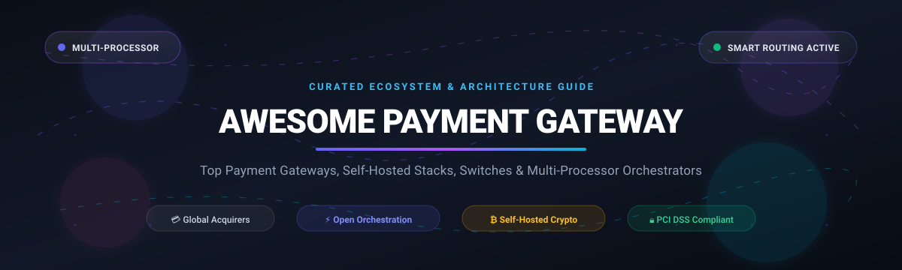

  

# 💳 Awesome Payment Gateway

  
  
  
  
  
  

> 🚀 **A curated directory of top payment gateway platforms, multi-processor orchestration engines, self-hosted payment APIs, crypto switches, and developer SDKs.**

---

## 📑 Table of Contents

- [🌐 Sector Overview & Market Dynamics](#-sector-overview--market-dynamics)
- [🏢 SaaS & Hosted Payment Platforms](#-saas--hosted-payment-platforms)
- [💻 Open-Source GitHub Projects](#-open-source-github-projects)
  - [⚡ Top Open-Source Frameworks & Switches](#-top-open-source-frameworks--switches)
  - [🛠️ Architectural Categorization & Deep Dive](#-architectural-categorization--deep-dive)
- [🤝 How to Contribute](#-how-to-contribute)
- [⚠️ Disclaimer & Compliance](#️-disclaimer--compliance)

---

## 🌐 Sector Overview & Market Dynamics

The global payment gateway market was valued at approximately **$30.8 billion in 2025 and is projected to surpass $88 billion by 2033**, compounding at an annual growth rate (CAGR) of over 14.5%. The sector is **moderately fragmented yet dominated by an oligopoly of mega-scale acquirers and developer ecosystems** (such as JPMorgan Chase, Fiserv, Stripe, Adyen, and Worldpay), driving merchants increasingly toward **payment orchestration layers** (like Hyperswitch) to hedge vendor lock-in, optimize interchange routing, and prevent single-point-of-failure outages.

---

## 🏢 SaaS & Hosted Payment Platforms

Below is a detailed comparison of industry-leading commercial payment gateway platforms, sorted in descending order by enterprise company size (market capitalization or latest enterprise valuation).

| 🏢 Provider | 📊 Valuation / Scale | 💰 Pricing (Starting Tiers) | 🎁 Free Tier Limit / Trial | 🌟 Key Focus & Highlights |
|:---|:---|:---|:---|:---|
| **[Chase Payment Solutions](https://www.chase.com/business/payments)** | **~$650B+ Market Cap** (JPMorgan Chase) | **2.6% + $0.10** per tapped/inserted transaction; **3.5% + $0.15** per keyed/e-commerce transaction | **Unlimited Sandbox Environment**; $0/mo standard software fee (hardware terminal sold separately from $49) | Backed by the world's largest banking group; seamless treasury and fast daily deposits for US merchants. |
| **[Fiserv](https://www.fiserv.com/)** | **~$75B+ Market Cap** (NYSE: FI) | **2.3% + $0.10** per in-person swipe; **2.9% + $0.30** for e-commerce (Clover SaaS plans from $14.95/mo) | **30-Day Free Sandbox Trial** for Clover Developer APIs and merchant gateway testing suite | Comprehensive global payment technology, massive acquiring footprint, and Clover POS hardware ecosystem. |
| **[Shopify Payments](https://www.shopify.com/payments)** | **~$105B+ Market Cap** (NYSE: SHOP) | **2.9% + $0.30** per online transaction (Basic Shopify plan @ $39/mo; 2.5% + $0.30 on Advanced) | **3-Day Free Trial**, followed by $1/month promotion for the first month | Turnkey integration for e-commerce storefronts, Shop Pay one-click checkout, and built-in fraud analysis. |
| **[Stripe](https://stripe.com/)** | **~$91B+ Valuation** | **2.9% + $0.30** per successful card charge (domestic); +1% for international cards, +1% currency conversion | **Free Forever Developer Sandbox** with complete API access and simulated charges; $0/mo account fee | The developer benchmark for flexible APIs, billing, global acquiring, automated tax, and unified payouts. |
| **[Adyen](https://www.adyen.com/)** | **~$45B+ Market Cap** (AMS: ADYEN) | **Interchange++ pricing**: **€0.11 ($0.12) fixed processing fee** + card scheme interchange fee per transaction | **Free Dedicated Test Account** with unlimited transactions in staging environment | Unified omnichannel commerce across 100+ countries, direct card scheme connections, and high-volume optimization. |
| **[Square](https://squareup.com/)** | **~$42B+ Market Cap** (Block, Inc. NYSE: SQ) | **2.6% + $0.10** per in-person tap/dip/swipe; **2.9% + $0.30** for online invoices and digital checkout | **Free Forever Plan** ($0 monthly platform fee; pay only per transaction); free Developer Sandbox | Popular plug-and-play merchant POS and online payments with fast onboarding and zero setup friction. |
| **[PayPal Braintree](https://www.braintreepayments.com/)** | **~$60B+ Market Cap** (PayPal NASDAQ: PYPL) | **2.59% + $0.49** per transaction (cards and digital wallets); 0.75% for ACH Direct Debit (capped at $5) | **Free Perpetual Sandbox Account** with full API keys and test card simulators; $0/mo account fees | Supports cards, PayPal, Venmo, Apple Pay, and Google Pay through a unified drop-in UI and SDK. |
| **[Worldpay](https://www.worldpay.com/)** | **~$20B+ Valuation** (Acquired / GTCR) | **Interchange+ pricing** (typically starting from **0.75% – 2.75% + £0.20/$0.20** per transaction based on plan) | **Free Developer Test Account** with sandbox credentials and transaction simulation APIs | Robust enterprise merchant processing and deep international cross-border acquiring rails. |
| **[Checkout.com](https://www.checkout.com/)** | **~$11B+ Valuation** | **Custom Interchange++ model** (indicative benchmark starting from **0.95% + €0.10/$0.10** per card transaction) | **Free Dedicated Sandbox Simulator** for integration testing; no monthly commitments for sandbox | High-performance enterprise card acquiring, fast settlement speeds, and specialized multi-currency routing. |
| **[Authorize.Net](https://www.authorize.net/)** | **Subsidiary of Visa (~$600B)** | **Payment Gateway Only**: **$25/month** + **$0.10** per transaction (+ $0.10 daily batch fee); **All-in-One**: 2.9% + $0.30 | **Free Developer Sandbox Account** with unlimited test transactions and full API integration tools | Veteran e-commerce payment gateway trusted for classic cart integrations, virtual terminals, and recurring billing. |

---

## 💻 Open-Source GitHub Projects

Explore the most popular self-hosted payment gateways, orchestration switches, multi-gateway abstraction layers, and crypto transaction engines. 

The list below is **sorted in descending order by GitHub Stars** ⭐:

### ⚡ Top Open-Source Frameworks & Switches

| 📦 Repository & Project | ⭐ Star Count | 💻 Primary Tech Stack | 📖 Core Category |
|:---|:---|:---|:---|
| 🔄 **[Hyperswitch (Juspay)](https://github.com/juspay/hyperswitch)** |  | `Rust`, `PostgreSQL`, `Redis` | Payment Orchestration Switch |
| 🛍️ **[Medusa Payments Ecosystem](https://github.com/medusajs/medusa)** |  | `TypeScript`, `Node.js` | Headless Commerce Payment Modules |
| 🧾 **[Lago](https://github.com/getlago/lago)** |  | `Ruby`, `Go`, `PostgreSQL` | Open-Source Metering & Billing Gateway |
| 💰 **[BTCPay Server](https://github.com/btcpayserver/btcpayserver)** |  | `C#`, `.NET Core` | Self-Hosted Bitcoin & Lightning Gateway |
| 🌐 **[Omnipay](https://github.com/thephpleague/omnipay)** |  | `PHP` | Multi-Gateway Payment Abstraction Library |
| 💳 **[Kill Bill](https://github.com/killbill/killbill)** |  | `Java`, `MySQL` | Open-Source Subscription Billing & Payments |
| 💎 **[Active Merchant](https://github.com/activemerchant/active_merchant)** |  | `Ruby` | Unified Payment Abstraction Library |
| ⚡ **[YouPI-PG](https://github.com/youpi-pg/YouPI-PG)** |  | `JavaScript`, `Node.js` | Self-Hosted UPI & Dynamic QR Gateway |
| 🏛️ **[Apache Fineract](https://github.com/apache/fineract)** |  | `Java`, `Spring Boot` | Core Banking & Financial Transaction Engine |
| 🔌 **[Payum](https://github.com/Payum/Payum)** |  | `PHP` | Modular Payment Processing Framework |
| 💵 **[USDT Payment Gateway](https://github.com/DigitalShieldOfficial/USDT-Payment-Gateway)** |  | `JavaScript`, `Web3` | Multi-Chain Stablecoin Payment Gateway |
| 🪙 **[Bitcart](https://github.com/bitcart/bitcart)** |  | `Python`, `FastAPI`, `Docker` | Multi-Cryptocurrency Non-Custodial Processor |
| 🛡️ **[SHKeeper](https://github.com/vsys-host/shkeeper.io)** |  | `Python`, `Docker` | Self-Hosted Crypto Gateway with CMS Plugins |
| ⚖️ **[TPT Pay](https://github.com/tpt-solutions/tpt-payments)** |  | `Go`, `PostgreSQL`, `NATS` | Stripe-Compatible Self-Hosted Payment Engine |
| 🌌 **[OphirPay](https://github.com/OphirPay/OphirPay)** |  | `TypeScript`, `Stellar SDK` | Stellar Blockchain Decentralized Gateway |

---

### 🛠️ Architectural Categorization & Deep Dive

#### 1. Multi-Processor Routing & Payment Orchestration
- **[Hyperswitch](https://github.com/juspay/hyperswitch)**: Built by Juspay in Rust, this PCI-compliant router connects to over 120 processors (Stripe, Adyen, Braintree, Worldpay, Checkout.com, etc.). Provides smart fallback routing, dynamic 3DS authentication, token vaulting, cost observability, and automated reconciliation.
- **[Kill Bill](https://github.com/killbill/killbill)**: Enterprise-grade open-source billing and payment platform that allows businesses to scale recurring revenue without processor lock-in.

#### 2. Payment Abstraction Libraries
- **[Active Merchant](https://github.com/activemerchant/active_merchant)**: Extracted originally from Shopify, this library delivers an iconic standardized Ruby interface across dozens of global gateways.
- **[Omnipay](https://github.com/thephpleague/omnipay)**: Multi-gateway PHP library designed with clean, expressive OOP principles to abstract away vendor-specific API variations.
- **[Payum](https://github.com/Payum/Payum)**: Flexible PHP payment engine supporting e-commerce shopping carts, recurring payments, and webhooks.

#### 3. Sovereign Self-Hosted APIs
- **[TPT Pay](https://github.com/tpt-solutions/tpt-payments)**: Go-based, Stripe-compatible REST API complete with HashiCorp Vault tokenization and an append-only double-entry financial ledger.

#### 4. Non-Custodial Cryptocurrency Processors
- **[BTCPay Server](https://github.com/btcpayserver/btcpayserver)**: The gold standard for non-custodial Bitcoin and Lightning Network transactions with zero third-party processing fees.
- **[Bitcart](https://github.com/bitcart/bitcart)**: Full-featured crypto processor supporting Bitcoin, Ethereum, Monero, Litecoin, and stablecoins.
- **[SHKeeper](https://github.com/vsys-host/shkeeper.io)**: Self-hosted crypto processor designed for clean integration with major CMS and shopping carts.

---

## 🤝 How to Contribute

Contributions to this ecosystem list are welcome! Follow these steps:

1. 🍴 **Fork the repository**.
2. 🌿 **Create a new branch** (`git checkout -b feature/add-new-gateway`).
3. 📝 **Add your entry** following the standardized markdown table format (including exact pricing, free trial specifications, and star badges).
4. 🚀 **Submit a Pull Request** with a concise description of the tool and links to official documentation.

---

## ⚠️ Disclaimer & Compliance

- 🔒 **PCI DSS Compliance**: Handling raw credit or debit card data requires rigorous compliance with the Payment Card Industry Data Security Standard (PCI DSS). Self-hosted solutions must undergo security hardening, strict tokenization, and audit validation.
- 🏦 **Acquiring Rails**: Open-source switches (e.g., Hyperswitch) provide orchestration, routing, and vaulting, but actual settlement and clearing of funds require active merchant accounts with licensed merchant acquirers or banks.
- 📜 **Licensing**: Always verify open-source licenses before commercial deployment.

---

  Curated with ❤️ by <a href="https://github.com/ishandutta2007">Ishan Dutta</a> and the global open-source fintech community.

